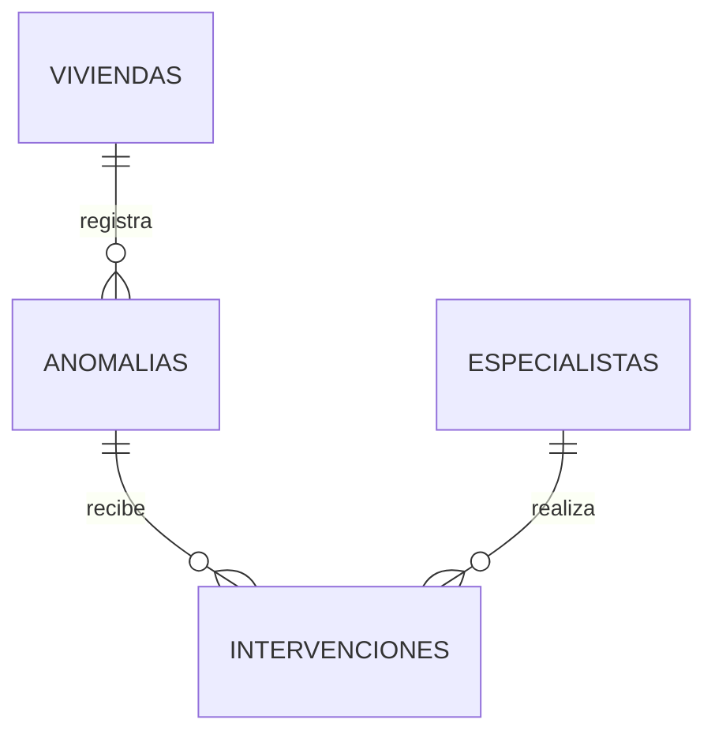
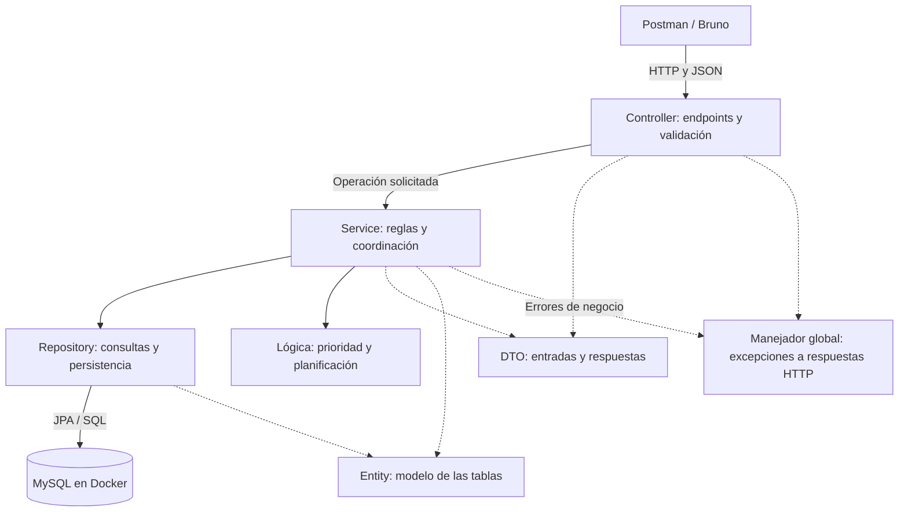

# Enunciado: Departamento de Anomalías Domésticas

## 1. Finalidad

En esta ciudad, las anomalías no aparecen en laboratorios secretos: aparecen en pisos de alquiler. Un pasillo crece, una nevera anuncia el futuro y un espejo decide tomarse el día libre.

El ayuntamiento necesita una API para registrar los avisos, consultar qué está ocurriendo, enviar al especialista adecuado y guardar el resultado de cada intervención.

**Tu objetivo es construir esa API, no una aplicación web de negocio con pantallas.** Al terminar deberías poder simular el trabajo de la oficina desde Swagger UI en `/`, Postman, Bruno o peticiones HTTP. La página de documentación ya está preparada, pero no implementa ni simula los endpoints.

### Nivel y límites

Nivel objetivo: **principiante con una base sólida, practicando sus primeros retos de lógica y Spring**. Algunas herramientas (DTO, paginación y errores globales) serán nuevas si acabas de empezar: se incorporan por pasos, no se presupone que las domines. No es un ejercicio de arquitectura de nivel mid.

Debes conocer clases, métodos, colecciones, condicionales y excepciones. Practicarás relaciones sencillas entre entidades, DTO, filtros, paginación y decisiones que afectan a varias tablas. La dificultad principal está en **pensar las reglas y el algoritmo**, no en añadir infraestructura.

No se pide autenticación, roles, tests, observabilidad, logs personalizados, microservicios, colas, caché, despliegue cloud, arquitectura hexagonal, ni migraciones con Flyway. Tampoco un sistema real de turnos, mapas o agenda. No añadas complejidad por añadirla.

## 2. Qué recibes y qué debes hacer

**Preparado:** proyecto Maven arrancable, dependencias, MySQL en Docker, tablas, datos de ejemplo y página raíz con Swagger UI. Su contrato manual está en `src/main/resources/static/openapi.json`; mantenlo alineado con los DTO y las rutas que implementes.

También tienes una guía en `/guia.html` con el recorrido de un caso y ejemplos educativos de cierres y prioridades. No ejecuta endpoints ni modifica la base de datos; sirve para entender las reglas antes de implementarlas.

**A implementar por ti:** entidades JPA, enums, repositorios, DTO, servicios, controladores y un manejo sencillo de errores. No están implementados ninguno de los endpoints de este documento.

## 3. El mundo del proyecto

### Vivienda

Un lugar con dirección, residente, email de contacto e instrucciones de acceso. Una vivienda puede acumular varias anomalías. No se intenta validar una dirección real ni gestionar propietarios.

### Anomalía

Un fenómeno detectado en una vivienda. Tiene título, descripción, disciplina, peligrosidad del **1 al 5**, estado y fecha de reporte.

Disciplinas:

| Valor | Qué estudia | Ejemplo |
| --- | --- | --- |
| `TEMPORAL` | Desajustes del tiempo | Una tostadora rebobina el desayuno |
| `ESPACIAL` | Distancias y espacios imposibles | Un dormitorio contiene una estación de tren |
| `REFLEJOS` | Espejos, sombras y dobles | Un reflejo lleva un jersey distinto |
| `SONORA` | Sonidos con comportamiento imposible | Las tuberías retransmiten conversaciones de las nubes |

Estados:

- `REPORTADA`: pendiente de atender; también se usa tras un intento sin cambios.
- `EN_ESTUDIO`: tiene una intervención abierta.
- `CONTENIDA`: resuelta por el momento; conserva su historial.
- `DESBORDADA`: un intento la ha empeorado y necesita otra intervención.

### Especialista

Tiene nombre, una sola disciplina, nivel de autorización del **1 al 5** y un indicador `activo`. El nivel indica qué peligrosidad máxima puede atender, no una puntuación que cambie automáticamente.

### Intervención

Relaciona una anomalía con un especialista. Guarda inicio, fin, resultado e informe. Está **abierta cuando `fecha_fin` es `NULL`**. No necesitas una columna adicional de estado.

Una anomalía conserva todas sus intervenciones anteriores. No se borra su historial al volver a atenderla.



Consulta `database/01-inicializar.sql` para los nombres, tipos y restricciones exactos. Mapea IDs como `Long`, las fechas como `LocalDateTime` y los enums como texto (`EnumType.STRING`). Evita borrados en cascada.

## 4. Reglas que hacen que esto no sea solo CRUD

### Registrar una anomalía

1. La vivienda debe existir.
2. Título y descripción no pueden estar vacíos; título de hasta 150 caracteres.
3. La disciplina debe ser válida y la peligrosidad estar entre 1 y 5.
4. El servidor asigna la fecha actual en UTC y el estado `REPORTADA`. No aceptes esos campos del cliente.

### Iniciar una intervención

1. Deben existir la anomalía y el especialista.
2. El especialista debe estar activo y tener la misma disciplina que la anomalía.
3. Su autorización debe ser igual o mayor que la peligrosidad.
4. Un especialista no puede tener dos intervenciones abiertas.
5. Una anomalía no puede tener dos intervenciones abiertas.
6. Solo pueden atenderse anomalías `REPORTADA` o `DESBORDADA`.
7. El servidor crea la intervención con inicio actual y sin fin, resultado ni informe; después cambia la anomalía a `EN_ESTUDIO`.

No hace falta programar asignación automática: el usuario elige `especialistaId` y la API comprueba si es válido.

### Cerrar una intervención

Solo se puede cerrar una intervención abierta. El cliente envía `resultado` e `informe`; el informe es obligatorio, no puede contener solo espacios y admite hasta 1500 caracteres. El servidor establece la fecha de fin.

| Resultado | Nuevo estado de la anomalía | Peligrosidad |
| --- | --- | --- |
| `CONTENIDA` | `CONTENIDA` | Se mantiene |
| `SIN_CAMBIOS` | `REPORTADA` | Se mantiene |
| `EMPEORADA` | `DESBORDADA` | Sube un punto, con máximo 5 |

El especialista queda libre porque la intervención ya tiene fecha de fin. No añadas un segundo indicador de disponibilidad que pueda desincronizarse.

**Importante:** iniciar y cerrar cambian varias filas. Usa `@Transactional` en el servicio para que no quede una intervención creada sin actualizar su anomalía, o viceversa. Para esta práctica basta con peticiones secuenciales; garantizar exclusión bajo peticiones simultáneas mediante bloqueos queda fuera del alcance.

No expongas un endpoint para cambiar el estado arbitrariamente: los estados cambian por estas operaciones.

### Calcular la prioridad de atención

La ciudad no atiende por orden de ID. Una anomalía peligrosa, antigua o desbordada merece más atención.

Para cada anomalía pendiente (`REPORTADA` o `DESBORDADA`) calcula:

```text
diasPendiente = días completos transcurridos desde fechaReporte hasta ahora en UTC
diasComputables = limitar diasPendiente al intervalo 0..7
prioridad = peligrosidad × 10 + diasComputables × 2
si está DESBORDADA: sumar 20
```

La fecha original se conserva aunque una intervención termine sin cambios. Una anomalía nunca obtiene puntos negativos por una fecha futura. El límite de siete días evita que un caso leve gane prioridad indefinidamente.

No guardes la prioridad en una columna: cambia con el tiempo. Calcula el valor al consultar y muéstralo en el DTO de anomalía. Para `EN_ESTUDIO` y `CONTENIDA`, devuelve prioridad `0`, porque no están pendientes de asignación.

Ejemplos independientes de los datos iniciales:

| Peligrosidad | Antigüedad | Estado | Prioridad |
| --- | --- | --- | --- |
| 3 | 2 días completos | `REPORTADA` | 34 |
| 2 | 10 días completos | `DESBORDADA` | 54 |
| 5 | 0 días completos | `REPORTADA` | 50 |
| 5 | 3 días completos | `CONTENIDA` | 0 |

### Proponer un plan de guardia: el reto principal de lógica

Construye `GET /api/guardia/propuesta`. No es otro CRUD: **calcula una propuesta de reparto de trabajo** a partir de la situación actual, sin guardar intervenciones ni cambiar estados.

El algoritmo debe seguir estas reglas, en este orden:

1. Recoge las anomalías `REPORTADA` y `DESBORDADA` que no tengan intervención abierta.
2. Calcula su prioridad usando **el mismo instante UTC para toda la propuesta**.
3. Ordénalas por prioridad descendente. En empate, primero la fecha de reporte más antigua y después el menor ID.
4. Recoge los especialistas activos que no tengan intervención abierta.
5. Recorre las anomalías en ese orden. Para cada una, busca candidatos de la misma disciplina con nivel suficiente.
6. Elige al candidato con **el nivel suficiente más bajo**. Así reservas a los especialistas de nivel alto para casos que realmente los necesitan. En empate, elige el menor ID.
7. Marca al especialista como utilizado **solo en la propuesta**, para no asignarlo de nuevo durante ese recorrido.
8. Si no hay candidato libre, incluye la anomalía en `sinAsignar` y continúa con la siguiente; no detengas todo el proceso.

Para cada caso sin asignar, distingue dos motivos:

- `SIN_ESPECIALISTA_COMPATIBLE`: no existe ningún especialista activo de esa disciplina y nivel suficiente, aunque ignorases su ocupación.
- `SIN_ESPECIALISTA_LIBRE`: existe alguno compatible y activo, pero está ocupado en la base de datos o ya fue utilizado en esta propuesta.

**No necesitas optimización matemática, IA, planificación de horarios ni SQL avanzado.** Basta con listas, ordenación, un recorrido y un conjunto de IDs utilizados. Es un algoritmo voraz sencillo: sigue las reglas anteriores; no tiene que encontrar el reparto óptimo entre todas las combinaciones posibles.

Respuesta ilustrativa (no representa necesariamente el SQL inicial):

```json
{
  "asignaciones": [
    { "anomaliaId": 20, "prioridad": 54, "especialistaId": 3 },
    { "anomaliaId": 21, "prioridad": 34, "especialistaId": 1 }
  ],
  "sinAsignar": [
    { "anomaliaId": 22, "prioridad": 30, "motivo": "SIN_ESPECIALISTA_LIBRE" }
  ]
}
```

Devuelve ambas listas en el orden en que el algoritmo atendió sus anomalías. Consultar la propuesta dos veces con el mismo estado de datos e instante de cálculo debe dar la misma respuesta.

La propuesta es informativa: para aceptar una asignación usa el `POST /api/intervenciones` existente. Ese endpoint **vuelve a validar todo**, porque la situación puede haber cambiado desde la consulta. No se pide un endpoint que confirme toda la guardia de golpe.

## 5. Endpoints propuestos

Todas las rutas empiezan por `/api`. Los nombres de campos JSON se escriben en camelCase aunque las columnas SQL usen guiones bajos.

| Método | Ruta | Función |
| --- | --- | --- |
| GET | `/viviendas` | Listar viviendas |
| POST | `/viviendas` | Registrar una vivienda |
| GET | `/viviendas/{id}` | Consultar una vivienda |
| GET | `/viviendas/{id}/anomalias` | Consultar sus anomalías; 404 si la vivienda no existe |
| GET | `/especialistas` | Listar especialistas; filtro opcional `disciplina` |
| GET | `/especialistas/disponibles?anomaliaId=1` | Solo activos, de disciplina compatible, nivel suficiente y sin intervención abierta; lista vacía si no hay candidatos y 404 si la anomalía no existe |
| POST | `/anomalias` | Registrar un fenómeno |
| GET | `/anomalias` | Listar con filtros opcionales `estado`, `disciplina` y `peligrosidadMinima` |
| GET | `/anomalias/{id}` | Consultar el detalle |
| GET | `/anomalias/{id}/intervenciones` | Historial ordenado por inicio descendente |
| POST | `/intervenciones` | Iniciar una intervención |
| PATCH | `/intervenciones/{id}/cierre` | Cerrar con resultado e informe |
| GET | `/resumen` | Consultar la situación de la ciudad |
| GET | `/guardia/propuesta` | Calcular prioridades y proponer asignaciones sin modificar datos |

Para viviendas valida dirección (obligatoria, hasta 200), residente (obligatorio, hasta 100), email (obligatorio, formato válido, hasta 150) e instrucciones opcionales (hasta 500). Los especialistas iniciales se gestionan desde el SQL: no necesitas su CRUD.

Para `/anomalias`, usa paginación básica con `page=0&size=10`, orden por `fechaReporte` descendente y, en empate, `id` descendente. `page` empieza en 0; `size` debe estar entre 1 y 50. Los filtros presentes se combinan con AND y `peligrosidadMinima` admite 1 a 5. Puedes usar `Pageable` y unas consultas de repositorio: no necesitas montar un motor genérico de filtros.

El detalle de anomalía debe incluir los datos principales de su vivienda; el historial puede ir en su endpoint propio. No devuelvas directamente entidades JPA: usa DTO para evitar ciclos JSON y decidir qué muestras.

La prioridad es un campo calculado del DTO, no un filtro ni una ordenación de la lista paginada. Conserva la ordenación por fecha de `/anomalias`; la ordenación por prioridad se utiliza en `/guardia/propuesta`. Esto evita mezclar el algoritmo con paginación y consultas más complejas.

### DTO, filtros y paginación sin sobrediseñar

- Crea entradas específicas: `CrearAnomaliaRequest`, `IniciarIntervencionRequest` y `CerrarIntervencionRequest`. Solo deben admitir los campos que el usuario puede decidir.
- Crea respuestas sencillas como `AnomaliaResponse`, `IntervencionResponse` y `PropuestaGuardiaResponse`. No necesitas un DTO distinto para cada variante mínima.
- Mapea a mano con métodos pequeños; no añadas MapStruct ni una jerarquía de mappers.
- Para la página puedes devolver una estructura con `contenido`, `pagina`, `tamano`, `totalElementos` y `totalPaginas`, calculada a partir de `Page`.
- Aplica los filtros en el repositorio, antes de paginar. Con estos tres filtros basta una consulta JPQL con parámetros opcionales; no necesitas Specifications ni Criteria API.
- En cambio, la propuesta de guardia puede cargar todas las anomalías pendientes y los especialistas: este es un conjunto pequeño y el ejercicio trata de practicar el algoritmo en Java.

### Ejemplos de peticiones

Registrar un aviso con `POST /api/anomalias`:

```json
{
  "viviendaId": 1,
  "titulo": "El microondas calienta el martes pasado",
  "descripcion": "La comida sale fría, pero el residente recuerda haber comido caliente hace una semana.",
  "disciplina": "TEMPORAL",
  "peligrosidad": 2
}
```

Iniciar con `POST /api/intervenciones`:

```json
{
  "anomaliaId": 1,
  "especialistaId": 1
}
```

Cerrar con `PATCH /api/intervenciones/{id}/cierre`:

```json
{
  "resultado": "EMPEORADA",
  "informe": "Al desenchufar la nevera apareció una segunda cocina correspondiente al próximo jueves."
}
```

### Resumen de la ciudad

`GET /api/resumen` devuelve:

- Número total de anomalías.
- Número en cada uno de los cuatro estados, incluyendo los que tengan cero.
- Número con peligrosidad 4 o 5 **no contenidas**.
- Número de intervenciones abiertas.

Con el SQL inicial, antes de hacer cambios, debe dar:

```json
{
  "totalAnomalias": 8,
  "porEstado": {
    "REPORTADA": 5,
    "EN_ESTUDIO": 1,
    "CONTENIDA": 1,
    "DESBORDADA": 1
  },
  "anomaliasCriticas": 2,
  "intervencionesAbiertas": 1
}
```

## 6. Respuestas y errores, sin complicarlo

- `200 OK`: consultas y cierre correcto.
- `201 Created`: vivienda, anomalía o intervención creada. Devuelve su ID en la respuesta.
- `400 Bad Request`: campos incorrectos, enum desconocido, filtros o paginación inválidos.
- `404 Not Found`: un recurso solicitado o referenciado no existe.
- `409 Conflict`: la operación contradice las reglas, por ejemplo asignar un especialista ocupado o cerrar algo ya cerrado.

Implementa **un manejo global de errores** con `@RestControllerAdvice`: no repitas bloques `try/catch` en cada controlador. Puedes usar dos excepciones propias sencillas: `RecursoNoEncontradoException` y `ReglaNegocioException`.

Para entradas usa `@Valid` con anotaciones como `@NotBlank`, `@NotNull`, `@Min`, `@Max`, `@Size` y `@Email`. Devuelve también `400` cuando el JSON no pueda leerse o incluya un enum desconocido.

Una respuesta de error sencilla puede contener `mensaje` y una lista `errores` de validación (vacía si no hay errores por campo). No devuelvas trazas, nombres internos de clases ni mensajes del motor SQL. No hace falta diseñar un catálogo empresarial de errores.

```json
{
  "mensaje": "La petición contiene campos inválidos",
  "errores": [
    { "campo": "peligrosidad", "mensaje": "Debe estar entre 1 y 5" }
  ]
}
```

## 7. Arquitectura y estructura del proyecto

Usa una **arquitectura sencilla por capas**, en una única aplicación Spring Boot. No necesitas arquitectura hexagonal, microservicios ni módulos Maven separados.

**Esta es la estructura que construirás durante la práctica**, no código ya implementado. Crea las clases conforme las necesites; no hace falta generar todos los archivos vacíos antes de empezar.

### 7.1. Vista general



Las flechas continuas muestran llamadas durante una petición. Las discontinuas muestran uso de datos o tratamiento de errores; el servicio no llama directamente al manejador global: lanza una excepción y Spring la dirige al `@RestControllerAdvice`.

### 7.2. Árbol de paquetes y clases

Todo el código debe estar **dentro de `com.example.anomalias`** para que Spring lo descubra:

```text
anomalias-domesticas/
├── pom.xml
├── compose.yaml
├── README.md
├── PROYECTO.md
├── database/
│   └── 01-inicializar.sql
└── src/main/
    ├── resources/
    │   ├── application.yml
    │   └── static/
    │       ├── index.html
    │       ├── guia.html
    │       ├── favicon.svg
    │       ├── openapi.json
    │       ├── css/
    │       │   ├── swagger.css
    │       │   └── guia.css
    │       └── js/
    │           ├── swagger.js
    │           └── guia.js
    └── java/com/example/anomalias/
        ├── AnomaliasApplication.java
        ├── controller/
        │   ├── ViviendaController.java
        │   ├── AnomaliaController.java
        │   ├── EspecialistaController.java
        │   ├── IntervencionController.java
        │   ├── GuardiaController.java
        │   └── ResumenController.java
        ├── service/
        │   ├── ViviendaService.java
        │   ├── AnomaliaService.java
        │   ├── EspecialistaService.java
        │   ├── IntervencionService.java
        │   ├── GuardiaService.java
        │   ├── ResumenService.java
        │   └── logic/
        │       ├── CalculadoraPrioridad.java
        │       ├── ReglasAsignacion.java
        │       └── PlanificadorGuardia.java
        ├── repository/
        │   ├── ViviendaRepository.java
        │   ├── AnomaliaRepository.java
        │   ├── EspecialistaRepository.java
        │   └── IntervencionRepository.java
        ├── entity/
        │   ├── Vivienda.java
        │   ├── Anomalia.java
        │   ├── Especialista.java
        │   └── Intervencion.java
        ├── dto/
        │   ├── request/
        │   │   ├── CrearViviendaRequest.java
        │   │   ├── CrearAnomaliaRequest.java
        │   │   ├── IniciarIntervencionRequest.java
        │   │   └── CerrarIntervencionRequest.java
        │   └── response/
        │       ├── ViviendaResponse.java
        │       ├── AnomaliaResponse.java
        │       ├── EspecialistaResponse.java
        │       ├── IntervencionResponse.java
        │       ├── PaginaResponse.java
        │       ├── ResumenResponse.java
        │       ├── PropuestaGuardiaResponse.java
        │       ├── AsignacionPropuestaResponse.java
        │       ├── AnomaliaSinAsignarResponse.java
        │       ├── ErrorResponse.java
        │       └── ErrorCampoResponse.java
        ├── enums/
        │   ├── Disciplina.java
        │   ├── EstadoAnomalia.java
        │   ├── ResultadoIntervencion.java
        │   └── MotivoSinAsignar.java
        └── exception/
            ├── RecursoNoEncontradoException.java
            ├── ReglaNegocioException.java
            └── GlobalExceptionHandler.java
```

Los nombres son una guía coherente con los endpoints, no una obligación de crear más capas. Los DTO pueden ser clases sencillas o `record`; `PaginaResponse<T>` puede reutilizarse si te resulta cómodo, pero no necesitas construir un sistema genérico de respuestas.

### 7.3. Responsabilidad de cada parte

| Parte | Qué hace | Qué no debe hacer |
| --- | --- | --- |
| `controller` | Define rutas, recibe DTO, aplica `@Valid` y devuelve códigos HTTP | Acceder a repositorios o decidir asignaciones |
| `service` | Busca datos, comprueba reglas, coordina operaciones y prepara respuestas | Recibir objetos HTTP como `HttpServletRequest` |
| `service/logic` | Calcula prioridades, comprueba compatibilidad y propone el reparto | Consultar MySQL, guardar entidades o decidir códigos HTTP |
| `repository` | Extiende `JpaRepository`, filtra, pagina y cuenta registros | Decidir qué ocurre al cerrar una intervención |
| `entity` | Representa tablas, columnas y relaciones JPA | Ser el contrato JSON de la API |
| `dto/request` | Define los campos permitidos y sus validaciones básicas | Permitir que el cliente decida fechas, estados o prioridad |
| `dto/response` | Define los datos que recibe el cliente | Exponer automáticamente todas las relaciones JPA |
| `enums` | Representa valores cerrados de disciplina, estado y resultado | Contener consultas o reglas de persistencia |
| `exception` | Traduce excepciones a errores HTTP consistentes | Ocultar fallos y devolver éxito cuando una operación falla |

### 7.4. Dónde colocar la lógica contundente

- **`CalculadoraPrioridad`:** recibe una anomalía y un instante de referencia; devuelve su puntuación. Reutilízala en `AnomaliaService` para los DTO y en el planificador para ordenar. No dupliques la fórmula.
- **`ReglasAsignacion`:** centraliza comprobaciones compartidas de actividad, disciplina y nivel. Recibe los datos que necesita, no los busca por su cuenta. Así iniciar una intervención y proponer una guardia no aplican reglas diferentes.
- **`PlanificadorGuardia`:** recibe anomalías pendientes, especialistas activos, los IDs de especialistas ya ocupados y el instante común de cálculo. Recorre, ordena, selecciona y genera la propuesta sin guardar nada. Conserva la información de los especialistas ocupados para distinguir los dos motivos de falta de asignación.
- **`GuardiaService`:** consulta los repositorios, reúne esos datos y llama al planificador. No implementes el recorrido en el controlador.
- **`IntervencionService`:** valida también la ocupación real y el estado de la anomalía, inicia intervenciones y aplica las consecuencias del cierre. Aquí van los métodos `@Transactional` que escriben en varias tablas.
- **`ResumenService`:** obtiene conteos y construye el resumen; no debe depender del controlador de anomalías.

Las tres clases de `service/logic` son clases Java pequeñas. Si Spring las inyecta, pueden llevar `@Component`; no necesitan interfaces, herencia ni patrones adicionales. El planificador puede reutilizar las otras dos por constructor.

### 7.5. Recorrido de dos operaciones

**Iniciar una intervención:**

```text
POST /api/intervenciones
  → IntervencionController recibe y valida IniciarIntervencionRequest
  → IntervencionService busca anomalía y especialista
  → ReglasAsignacion comprueba actividad, disciplina y nivel
  → El servicio comprueba estado y ausencia de intervenciones abiertas
  → Guarda intervención y actualiza anomalía en una transacción
  → Construye IntervencionResponse
  → El controlador devuelve 201
```

Si alguna regla falla, el servicio lanza `ReglaNegocioException`; el manejador global devuelve `409`. Si falta un recurso, devuelve `404`. En ninguno de esos casos se inicia la intervención.

**Consultar el plan de guardia:**

```text
GET /api/guardia/propuesta
  → GuardiaController llama a GuardiaService
  → El servicio obtiene pendientes, especialistas y ocupaciones
  → PlanificadorGuardia calcula prioridades y reparte candidatos
  → El servicio devuelve PropuestaGuardiaResponse
  → El controlador devuelve 200, sin realizar escrituras
```

### 7.6. Límites para mantener la arquitectura sencilla

1. Inyección por constructor, sin `@Autowired` en atributos.
2. Los controladores llaman a servicios; los servicios llaman a repositorios o a las clases de lógica. Nunca llames a otro controlador.
3. Cada repositorio es una interfaz de Spring Data; cada servicio puede ser una clase concreta. No necesitas parejas `Service` / `ServiceImpl`.
4. Haz los mapeos con métodos privados pequeños en los servicios. No es obligatorio añadir un paquete `mapper`.
5. Para las relaciones, basta con `Anomalia → Vivienda` e `Intervencion → Anomalia / Especialista` mediante `@ManyToOne`. No necesitas colecciones bidireccionales: consulta el historial y las anomalías de una vivienda mediante repositorios.
6. Construye los DTO que requieren datos de relaciones dentro de un método de servicio `@Transactional(readOnly = true)`, especialmente si utilizas carga `LAZY`. `open-in-view` seguirá desactivado.
7. Valida todas las reglas antes de escribir y conserva una única transacción para iniciar o cerrar. No se pide resolver concurrencia avanzada.
8. No añadas un paquete `config`, utilidades genéricas ni interfaces vacías si todavía no tienen una necesidad concreta.

### 7.7. Uso de Lombok

Lombok ya está configurado en `pom.xml`. Úsalo para quitar código repetitivo, no para ocultar las reglas del proyecto.

| Tipo de clase | Anotaciones recomendadas |
| --- | --- |
| Entidades JPA | `@Getter`, `@Setter` y `@NoArgsConstructor(access = AccessLevel.PROTECTED)` |
| Servicios y controladores | `@RequiredArgsConstructor`, con dependencias en atributos `private final` |
| DTO de entrada como clases | `@Getter`, `@Setter` y `@NoArgsConstructor` |
| DTO de respuesta como clases | `@Getter` y `@AllArgsConstructor`; `@Builder` si facilita construir respuestas |
| DTO definidos como `record` | No necesitan Lombok: Java ya genera constructor y métodos de acceso |

Por ejemplo, un servicio puede declarar sus dependencias así (fragmento orientativo, no implementación del ejercicio):

```java
@Service
@RequiredArgsConstructor
public class AnomaliaService {
    private final AnomaliaRepository anomaliaRepository;
    private final ViviendaRepository viviendaRepository;
    private final CalculadoraPrioridad calculadoraPrioridad;

    // Aquí implementarás las operaciones y reglas.
}
```

Lombok genera el constructor con esas dependencias y Spring lo usa para inyectarlas; no necesitas escribir el constructor ni poner `@Autowired` en los atributos.

**Precauciones sencillas:**

- Evita `@Data` en entidades JPA: genera también `toString`, `equals` y `hashCode`, que pueden recorrer relaciones o dar problemas con entidades persistentes.
- No generes `toString`, `equals` o `hashCode` incluyendo relaciones JPA. Para esta práctica no es necesario personalizarlos.
- Mantén el constructor sin argumentos de las entidades, público o protegido, porque JPA lo necesita.
- No uses `@Builder` en entidades por ahora; resérvalo para DTO de respuesta si te resulta útil.
- No añadas `@Slf4j` ni configuración de logs: siguen fuera del alcance solicitado.
- Las comprobaciones de compatibilidad, prioridad y cierre siguen siendo métodos escritos por ti; Lombok no sustituye esa lógica.

## 8. Ruta de trabajo

1. **Arranque y lectura:** levanta MySQL, consulta las cuatro tablas y ejecuta Java. Abre `/` para explorar Swagger UI. Un 404 en los endpoints `/api/**` todavía no implementados es normal.
2. **Modelo:** crea entidades y enums. Comprueba que JPA valida el esquema al arrancar. Después añade repositorios.
3. **Primer recorrido:** implementa listar viviendas, detalle de vivienda, registrar anomalía y consultar su detalle usando DTO.
4. **Búsqueda:** añade filtros, paginación e historial. Evita cargar todos los registros para filtrarlos en Java.
5. **Asignación:** consulta especialistas disponibles y permite iniciar intervenciones aplicando todas las reglas.
6. **Desenlace:** implementa el cierre y verifica que modifica estado y peligrosidad correctamente.
7. **Prioridades:** escribe un método pequeño para la fórmula y comprueba los cuatro ejemplos con cálculos manuales.
8. **Plan de guardia:** construye la propuesta con listas, ordenación y un conjunto de especialistas utilizados. Primero comprueba un caso con dos anomalías y un especialista; después usa los datos completos.
9. **Tablón municipal:** implementa el resumen mediante conteos de repositorio, sin traer todas las entidades.
10. **Pulido:** añade validaciones y respuestas globales de error coherentes. Recorre los casos manuales siguientes.

## 9. Casos manuales para saber si funciona

Empieza con los datos iniciales. Para repetir todo desde cero, usa el reinicio de volumen explicado en el README, sabiendo que elimina los cambios de esta práctica.

1. El resumen coincide con el ejemplo: 8 anomalías y una intervención abierta.
2. Para la anomalía **1**, solo aparece como candidata la especialista **1**. Tomás (**5**) no tiene nivel suficiente.
3. Intenta asignar la anomalía **1** a la especialista **4**: debe dar `409` por disciplina incompatible.
4. Intenta asignar la anomalía **5** al especialista **2**: debe dar `409`; además de estar ocupado, su nivel es insuficiente. No importa qué regla informes primero.
5. Inicia la anomalía **1** con la especialista **1**: pasa a `EN_ESTUDIO`. Guarda el ID devuelto, no lo supongas.
6. Intenta asignar la anomalía **7** a la misma especialista: debe dar `409` por estar ocupada.
7. Cierra la intervención creada con `EMPEORADA`: la anomalía **1** queda `DESBORDADA`, pasa de nivel 3 a 4 y la especialista queda libre.
8. Repite el cierre del mismo ID: debe dar `409` y no subir de nuevo la peligrosidad.
9. Inicia otra intervención de la anomalía **1** con la especialista **1** y ciérrala con `CONTENIDA`. Ambas intervenciones deben seguir en el historial.
10. Cierra la intervención inicial **1**, del pasillo, con `SIN_CAMBIOS`: la anomalía **2** vuelve a `REPORTADA` y el especialista **2** queda libre.
11. Comprueba que la anomalía **5**, ahora sin el obstáculo del especialista ocupado, sigue sin tener candidatos: no hay especialista espacial de nivel 5. Una lista vacía es correcta.
12. Prueba un email inválido, peligrosidad 9, título vacío, cierre sin informe e IDs inexistentes. Debes recibir errores claros, sin cambios parciales en la base de datos.

### Comprobaciones del algoritmo de guardia

Haz estas comprobaciones con los datos iniciales restaurados y antes de iniciar nuevas intervenciones:

1. La anomalía **5** queda sin asignar por `SIN_ESPECIALISTA_COMPATIBLE`: no existe especialista espacial activo de nivel 5.
2. La anomalía **3** recibe a la especialista **3**. La anomalía **8**, de la misma disciplina, queda sin asignar por `SIN_ESPECIALISTA_LIBRE`: la candidata se ha usado ya en la propuesta.
3. La anomalía **1** recibe a la especialista **1**, mientras que la **7** recibe al especialista **5**. El especialista de nivel 1 basta para la tostadora; no necesita una experta de nivel 4.
4. La anomalía **6** recibe a la especialista **4**. La especialista **6** no participa porque está inactiva, aunque tenga mayor nivel.
5. La anomalía **2** no aparece en ninguna lista: está `EN_ESTUDIO` y ya tiene una intervención abierta.
6. Ningún especialista aparece dos veces en `asignaciones`.
7. Después de consultar, siguen existiendo solo las tres intervenciones del SQL inicial y no han cambiado los estados.
8. Comprueba la fórmula con antigüedad superior a siete días y, en un ejemplo aislado, una fecha futura: el tiempo aporta entre 0 y 14 puntos, nunca fuera de ese rango.
9. En un ejemplo aislado con dos anomalías de igual prioridad, verifica los desempates por fecha e ID. Para dos especialistas con igual nivel suficiente, verifica el menor ID.

## 10. Cuándo darlo por terminado

- [ ] Arranca contra MySQL en Docker, no contra una base en memoria.
- [ ] Las cuatro entidades reflejan el SQL y las relaciones funcionan.
- [ ] Se puede registrar una anomalía, buscarla y consultar su vivienda.
- [ ] La asignación comprueba disciplina, autorización y disponibilidad.
- [ ] Los tres resultados de cierre producen el estado correcto.
- [ ] Nunca sube la peligrosidad por encima de 5.
- [ ] Se conserva el historial sin borrados en cascada.
- [ ] Los filtros, la paginación y el resumen funcionan.
- [ ] Las entradas y respuestas usan DTO con mapeos sencillos.
- [ ] Los errores de validación y negocio se manejan globalmente.
- [ ] La prioridad respeta la fórmula, los límites y los estados.
- [ ] El plan de guardia atiende primero los casos prioritarios y reserva especialistas de mayor nivel cuando puede.
- [ ] La propuesta no repite especialistas, explica los casos sin asignar y no modifica la base de datos.
- [ ] Los errores no dejan operaciones a medias.
- [ ] No se han añadido frameworks ni capas innecesarias.

**No añadas más requisitos por ahora.** Con el registro, las reglas de intervención, los DTO, las consultas paginadas, los errores globales y el algoritmo de guardia ya hay una práctica completa. Terminarla y entenderla vale más que incorporar nuevas tecnologías.
